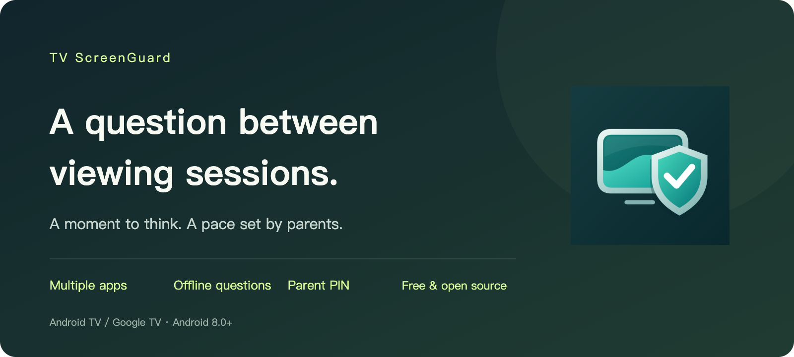
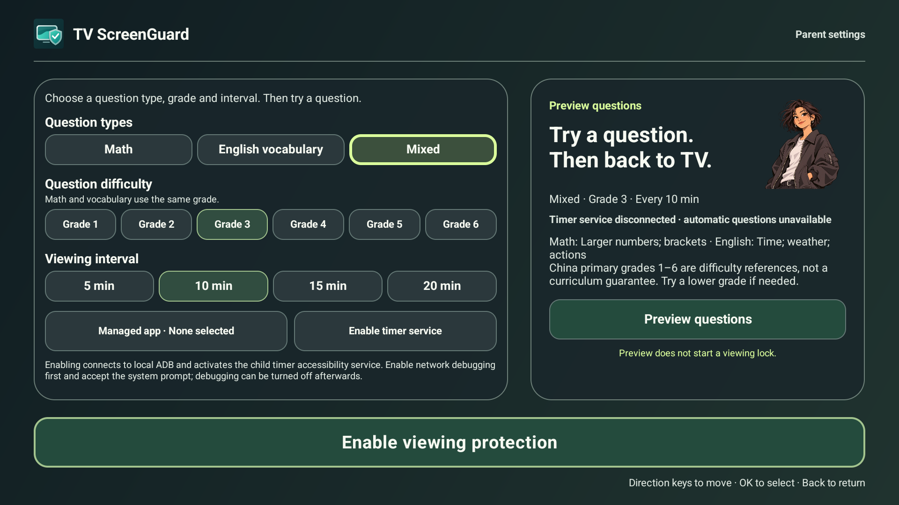
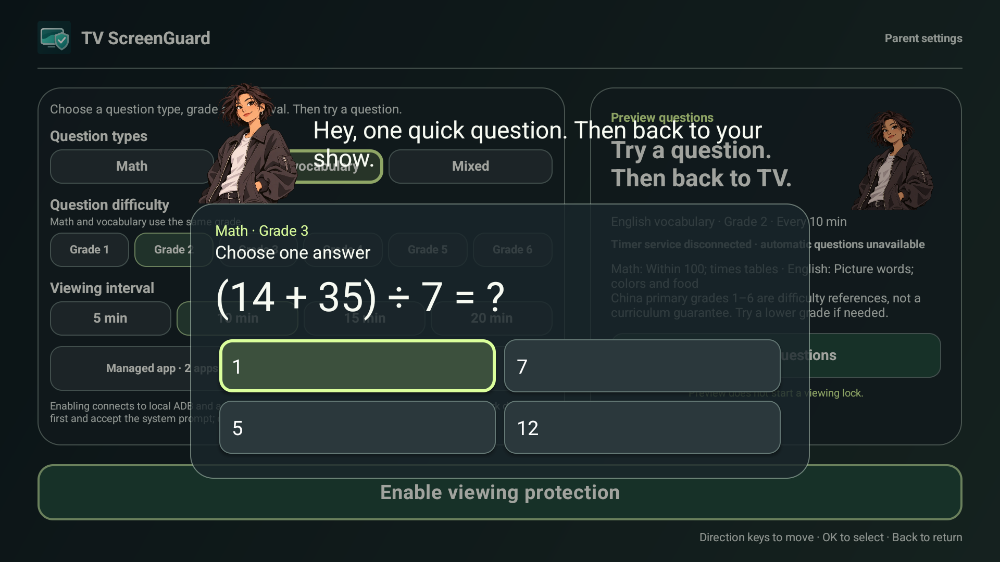

<p align="center"></p>

<h1 align="center">TV ScreenGuard</h1>
<p align="center"><strong>A question between viewing sessions.</strong></p>
<p align="center">A lightweight viewing companion for Android TV and Google TV.<br>Let parents set the pace, with a moment to think between sessions.</p>
<p align="center"><a href="README.md">简体中文</a> · English</p>



## Let parents set the pace

Choose the apps to manage and set a viewing interval. When time is up, a question appears. A correct answer unlocks the current round so viewing can continue. Three incorrect answers start a rest period; a parent can also step in with their PIN.

- **Manage several apps.** Select the apps you want to manage without replacing your TV home screen.
- **Choose your interval.** Set 5, 10, 15 or 20 minutes. The default is 10 minutes.
- **Pause for a question.** Choose math, English vocabulary or a mix, with six difficulty levels.
- **Keep settings in adult hands.** A 4–8 digit parent PIN is required each time settings are reopened.
- **Keep the current round.** Pending questions and rest states are saved when the interface closes.
- **Use it offline.** Free and open source, with no ads, analytics or cloud account. Questions used for viewing restrictions are stored locally.

## A look inside





These screenshots show the current English interface on an emulator using the normal Debug build, without the 30-second QA option. Display and player behaviour may vary on your TV.

## Get started

1. **Install and create a PIN.** Install the APK on an Android TV or Google TV device running Android 8.0 or newer. Open TV ScreenGuard and create your parent PIN. Keep it safe: there is no universal recovery password.
2. **Choose your apps and interval.** Select managed apps, question type, difficulty and viewing interval. Try the question preview first if you like.
3. **Enable the service and protection.** Enable the TV ScreenGuard accessibility timer service, then turn on viewing protection at the bottom of the settings page. Confirm the service status reports that protection is active before viewing.

Use the remote's direction keys to move, OK to select and Back to exit. Chinese and English interfaces follow the system language.

## Before you install

- Requires Android TV / Google TV, Android 8 / API 26 or newer. Samsung Tizen, LG webOS and Hisense VIDAA cannot install Android APKs.
- The accessibility service detects which managed app is in the foreground and displays questions. Timing follows foreground app use, including some paused playback. Switching to another app or entering standby pauses accumulation.
- When time is up, the app attempts to pause playback and restrict viewing. A correct answer removes the restriction and attempts to resume playback. Picture, sound and playback progress depend on the device and player. A previous QA package was tested with Tencent Video on B3P; this renamed Release package has not yet been retested on that box.
- Force-stopping the app, revoking accessibility access, vendor background management or switching inputs may interrupt protection. This is not tamper-proof parental control. It does not replace Home or disable other apps.
- The verified DBB3 Pro / Android 9 firmware has a dedicated background-protection adapter. Other devices require testing.
- New draft English question packs are preview-only and are not used for enforced questions. Difficulty levels are inspired by Chinese primary grades 1–6 and do not represent complete curriculum coverage.

Some devices support the in-app timer-service activation helper. Enable legacy network ADB, enter the port actually shown by the device and accept Android's authorisation prompt on the TV. The helper connects only to the TV itself. Devices with pairing-only wireless debugging or vendor restrictions may not support it. Turn ADB debugging off afterwards. You can also enable the service directly in system accessibility settings.

## Version and downloads

The current version is **1.0.14 Release**, application ID **`com.tv.screenguard`**, signed with the same production certificate as GenTV. The Release build has minute-based intervals only and no 30-second test entry. Signed packages and checksums are available from [GitHub Releases](https://github.com/Elaine-Lynn/tvscreenguard/releases/latest).

The previous test package, `com.tvguard.app`, is a separate Android application. The new package needs a new PIN, managed-app selection and accessibility approval. Turn off protection in the old app before enabling the new one. Existing settings are not migrated automatically.

GitHub project display name: **TV ScreenGuard**. Repository slug: **`tvscreenguard`**. [Repository](https://github.com/Elaine-Lynn/tvscreenguard) · [Download](https://github.com/Elaine-Lynn/tvscreenguard/releases/latest).

## Build

Use JDK 17, Android SDK 34 and build-tools 34.0.0.

```sh
./gradlew --no-daemon testDebugUnitTest lintDebug assembleDebug
```

Release signing reads an external private configuration file. Do not copy or commit signing material.

```sh
export SCREENGUARD_SIGNING_PROPERTIES=/private/path/signing.properties
./gradlew --no-daemon testReleaseUnitTest lintRelease assembleRelease
```

Required fields: `storeFile`, `storePassword`, `keyAlias`, `keyPassword`. The keystore path is relative to the configuration file. Release packaging fails if configuration is missing or the certificate does not match the approved GenTV certificate. Output: `app/build/outputs/apk/release/app-release.apk`.

For isolated testing, `-PguardTimerTest=true assembleDebug` adds a 30-second option. This does not enable short intervals in Release. See [validation notes](docs/validation.md) and the [1.0.14 Release record](docs/release-1.0.14.md).

## Origins, privacy and licence

Extracted from the viewing-protection module in [GenTV](https://github.com/Elaine-Lynn/GenTV) 3.7.12. TV ScreenGuard can coexist with GenTV and does not require a different launcher. Original copyright notices and MIT licensing are preserved. See [THIRD_PARTY_NOTICES.md](THIRD_PARTY_NOTICES.md), `licenses/` and the [privacy statement](PRIVACY.md).
