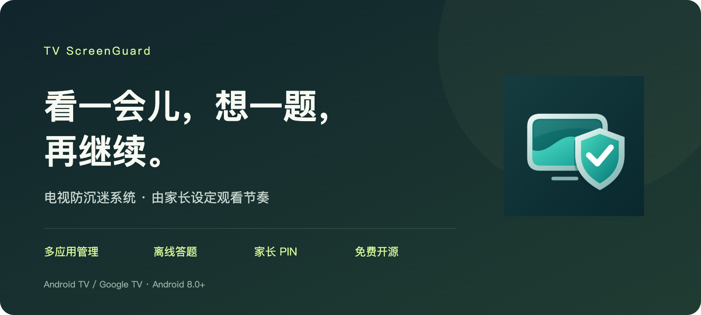
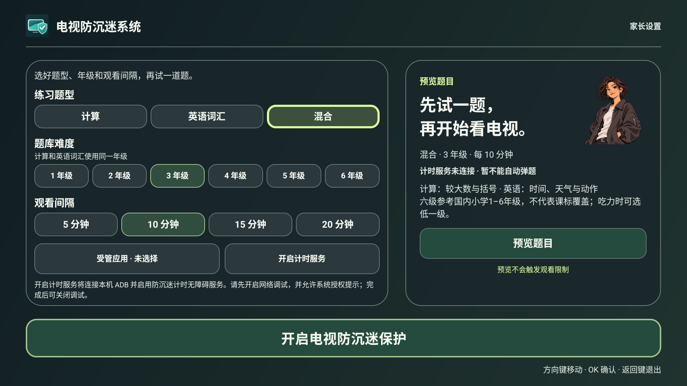
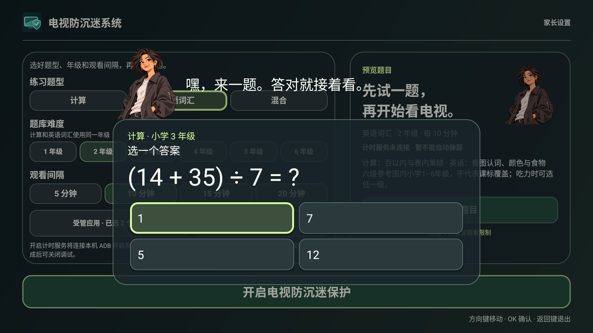

<p align="center"></p>

<p align="center">简体中文 · <a href="README.en.md">English</a></p>

<h1 align="center">TV ScreenGuard · 电视防沉迷系统</h1>
<p align="center"><strong>看一会儿，想一题，再继续。</strong></p>
<p align="center">为 Android TV 和 Google TV 打造的轻量观看管理工具。<br>由家长设定节奏，让连续观看之间多一次思考。</p>



## 把观看节奏，交给家长

选好需要管理的视频应用，设置观看间隔。计时到点后，电视会弹出一道题；答对后解除本轮限制，继续观看。连续三次答错则进入休息，家长也可以通过 PIN 处理。

- **多个应用，一起管理。** 自由选择受管应用，无需更换电视桌面。
- **时间由你安排。** 支持 5、10、15、20 分钟，默认 10 分钟。
- **思考之后再继续。** 计算、英语词汇或混合题型，提供小学 1–6 级难度选择。
- **设置由家长掌握。** 4–8 位数字 PIN，每次重新进入设置都需要验证。
- **断开页面，保留本轮。** 待答题目和休息状态会保存，重新进入后继续处理。
- **离线使用，专注眼前。** 免费开源，无广告、统计或云端账号；正式答题使用本地题库。

## 界面一览





配图为当前版本的模拟器界面，展示中文设置与答题流程；电视的实际显示和播放器行为因机型而异。

## 三步开始

1. **安装并设定密码。** 在 Android 8.0 及以上的 Android TV / Google TV 上安装 APK，打开“电视防沉迷系统”，创建家长 PIN。请妥善记住密码，本应用没有通用密码。
2. **选择应用与节奏。** 选择受管应用、题型、难度和观看间隔，可先预览题目。
3. **开启服务与保护。** 开启“电视防沉迷系统”计时无障碍服务，再打开页面底部的防沉迷保护。确认页面显示“计时保护已生效”后开始观看。

遥控器方向键移动，OK 确认，返回键退出。界面支持中文和英文，跟随系统语言。

## 安装前了解

- 适用于 Android TV / Google TV，最低 Android 8 / API 26。Samsung Tizen、LG webOS、Hisense VIDAA 无法安装 Android APK。
- 本应用通过无障碍服务识别受管应用是否在前台，并显示题目。计时依据前台停留，播放器暂停时也可能累计；切换到其他应用或待机时暂停累计。
- 到点会尝试暂停播放器并限制观看，答对后解除限制并尝试恢复。恢复画面、声音和进度的表现取决于播放器与设备。B3P 的既有测试版已由在场用户确认腾讯视频暂停、静音及答对恢复；新包名 Release 尚未在该盒子复测。
- 系统强退、撤销无障碍权限、厂商后台管理或切换输入源可能中断保护。本应用不提供不可绕过的系统级限制，不接管 Home，不禁用其他应用。
- DBB3 Pro / Android 9 的已验证固件有专用后台保护适配；其他机型仍需实测。
- 英语题包中的新增待审草稿仅供预览，不进入正式强制答题。难度分级不代表完整课标覆盖。

部分设备可使用应用内“开启计时服务”辅助入口：先打开传统网络 ADB 调试，填写设备实际显示的端口，并在电视接受授权。此功能仅连接电视自身；仅无线配对调试或受厂商限制的设备可能不支持。完成后请关闭 ADB 调试，也可以直接通过系统无障碍设置开启服务。

## 下载与版本

当前版本 **1.0.14 Release**，包名 **`com.tv.screenguard`**，与 GenTV 使用同一正式签名证书。正式版本仅提供分钟级间隔，不含 30 秒测试入口。正式签名包与校验文件见 [GitHub Releases](https://github.com/Elaine-Lynn/tvscreenguard/releases/latest)。

从旧测试包 `com.tvguard.app` 切换时，Android 将其视为新应用，需重新设置 PIN、受管应用和无障碍服务。请先在旧版关闭保护，再启用新版，避免同时运行两套计时服务；旧数据不会自动迁移。

GitHub 项目显示名称：**TV ScreenGuard**；仓库 slug 使用 **`tvscreenguard`**。[GitHub 仓库](https://github.com/Elaine-Lynn/tvscreenguard) · [下载 Release](https://github.com/Elaine-Lynn/tvscreenguard/releases/latest)。

## 开发与构建

JDK 17、Android SDK 34、build-tools 34.0.0。

```sh
./gradlew --no-daemon testDebugUnitTest lintDebug assembleDebug
```

正式构建从外部私有文件读取签名配置，不复制或提交密钥：

```sh
export SCREENGUARD_SIGNING_PROPERTIES=/private/path/signing.properties
./gradlew --no-daemon testReleaseUnitTest lintRelease assembleRelease
```

配置字段为 `storeFile`、`storePassword`、`keyAlias`、`keyPassword`；`storeFile` 相对配置文件目录解析。缺少签名或证书与已批准的 GenTV 证书不匹配时，Release 打包失败。APK 位于 `app/build/outputs/apk/release/app-release.apk`。

测试阶段可显式构建 `-PguardTimerTest=true assembleDebug`，增加 30 秒测试选项。该参数不启用 Release 的短计时。验证与设备记录见 [docs/validation.md](docs/validation.md)，本次交付见 [Release 记录](docs/release-1.0.14.md)。

## English

See [the English README](README.en.md) for the English introduction and screenshots.

## 来源、隐私与许可

独立提取自 [GenTV](https://github.com/Elaine-Lynn/GenTV) 3.7.12 的防沉迷模块，可与 GenTV 并存，无需更换桌面。保留原作者版权与 MIT 许可；第三方资源许可见 [THIRD_PARTY_NOTICES.md](THIRD_PARTY_NOTICES.md) 和 `licenses/`。隐私说明见 [PRIVACY.md](PRIVACY.md)。
